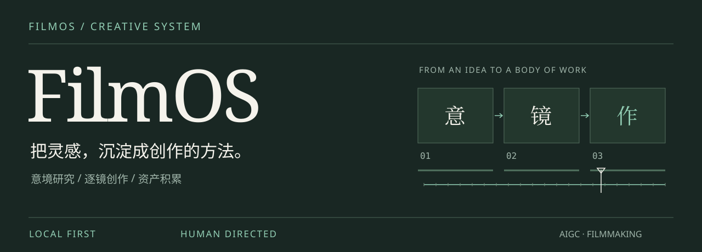
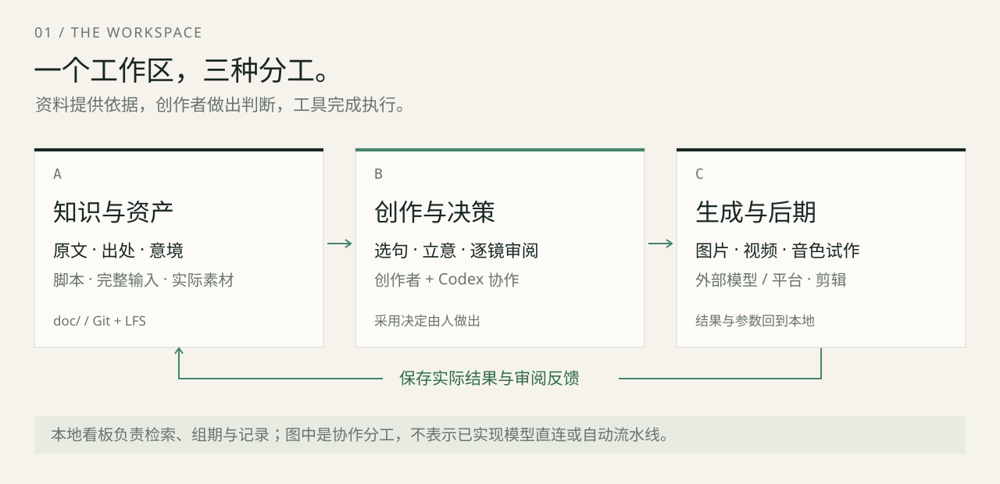
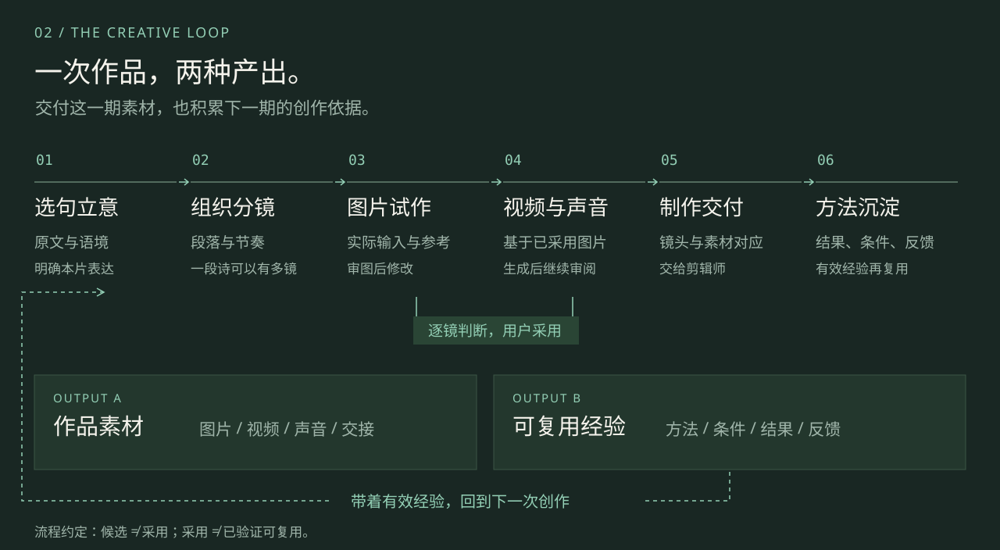

<p align="center">
  <a href="#开始使用">开始使用</a> ·
  <a href="#创作循环">创作循环</a> ·
  <a href="doc/README.md">文档中心</a> ·
  <a href="AGENTS.md">协作约定</a>
</p>

**FilmOS 是面向个人创作者的本地 AIGC 影像工作区。** 从诗句的选择、意境的组织，到分镜、图片、视频与交付，把创作过程中值得保留的判断和资产放在一起，让下一部作品有据可循。

当前从 **古诗词意境短片** 开始：一两句诗可以成为一个段落，不同作品的诗句可以共同表达一个主题，一段诗也可以展开为多个横屏镜头。

## 工作区



| 能力 | 在 FilmOS 中如何使用 |
| :--- | :--- |
| **找到一句诗** | 检索原文与连续摘句，按主题、意境和共鸣方向筛选，保留出处与上下文。 |
| **组织一期作品** | 跨作品选句，明确表达，排列段落与镜头；用本地看板维护制作状态。 |
| **逐镜积累资产** | 保存完整输入、参考素材、实际结果与审阅；用户决定采用哪一个版本。 |
| **带着经验再创作** | 共用提示词结构、项目审美与单镜输入分层保存，有效方法注明适用条件。 |

资料库现有 **21,615 条来源记录 · 135,918 个连续摘句片段**。分类主要为规则初分，适合作为选材入口；正式创作仍需核对原文、语境及教材范围。

## 创作循环



**创作者掌握审美与采用决定。** Codex 协助研究、组织脚本、调整提示词和整理记录。本地看板负责检索、组期与归档，生成和剪辑在对应工具中完成。

每次试作同时保留“用了什么”和“为什么这样选”。经过结果与使用条件支持的经验，再进入共用方法库。完整约定见[逐镜制作协作](doc/项目/01-古诗词意境/逐镜制作协作约定.md)。

## 创作方向

| | 项目 | 内容 | 阶段 |
| :--- | :--- | :--- | :--- |
| **01** | [古诗词意境](doc/项目/01-古诗词意境/README.md) | 以诗句组织主题、景物、人物与情绪，制作横屏短片 | 当前主线 |
| **02** | [中式巨物美学](doc/项目/02-中式巨物美学/README.md) | 中国景观、尺度感与幻想空间 | 方向储备 |
| **03** | [王者诸韵记](doc/项目/03-王者诸韵记/README.md) | 世界观、人物冲突与连续叙事 | 暂存 |

各项目独立保存内容、资产与专属提示词；跨项目有效的方法进入共用目录。当前《云起时》V5 图片已定稿，视频已整理，音色仍在比较。制作进展见[当前交付状态](doc/项目/01-古诗词意境/交付/当前交付状态.md)。

## 开始使用

准备 Git、[Git LFS](https://docs.github.com/en/repositories/working-with-files/managing-large-files/installing-git-large-file-storage) 与 Python。当前以 **Python 3.13** 验证，运行看板无需第三方 Python 包。

```bash
# 初始化 LFS 并获取工作区
git lfs install
git clone https://github.com/Liuhb1024/FilmOS.git
cd FilmOS
git lfs pull

# 启动本地看板
python3 -m app.server
```

打开 **http://127.0.0.1:8765**，从检索诗句和组建一期作品开始。端口占用时，可添加 `--port 8767`。

看板用于本机个人协作，未集成模型直连。使用方式与操作范围见[看板使用说明](doc/看板/使用说明.md)。

## 目录约定

```text
FilmOS/
├── AGENTS.md                 创作与工程协作规则
├── app/                      本地服务与原生前端
├── tests/                    自动测试
├── scripts/                  语料与摘句处理
└── doc/
    ├── 项目/
    │   ├── 01-古诗词意境/    选题库 → 分期 → 资产库 → 交付
    │   ├── 02-中式巨物美学/
    │   └── 03-王者诸韵记/
    ├── 共用/                 共用提示词、模板与方法
    ├── research/             研究与来源核对
    ├── 看板/                 使用与设计说明
    ├── 设计/                 原创说明图表
    └── 维护/                 清理、迁移与同步记录
```

**资料留在本地文件，变更交给版本管理。** 代码与文字使用 Git，精选制作媒体使用 Git LFS。每份媒体保留一个主要位置；采用版本、待选候选与历史记录分别标明。

<details>
<summary><strong>媒体存储与获取</strong></summary>

当前精选制作素材包含 16 张 V5 图片、16 段视频和 6 个音色试听候选，详见[媒体索引](doc/项目/01-古诗词意境/资产库/媒体索引.md)。本页展示的图形均为专门绘制的 SVG 示意图。

使用 `git clone` 与 `git lfs pull` 获取真实媒体文件。教材截图、来源 PDF 等尚未核定再分发许可的研究资料仅保留本地。LFS 存储与下载受仓库账号配额约束，参阅 [GitHub LFS 计量说明](https://docs.github.com/en/billing/concepts/product-billing/git-lfs)。

</details>

<details>
<summary><strong>开发与验证</strong></summary>

服务使用 Python 标准库，前端为原生 HTML、CSS 与 JavaScript。Node.js 仅用于下列前端语法检查。

```bash
python3 -m unittest discover -s tests -v
node --check app/web/app.js
node --check app/web/excerpts.js
git lfs fsck
```

正式制作主数据为 `doc/项目/01-古诗词意境/分期/看板数据.json`，通过本地 API 或 `Store` 修改，保留历史版本与归档作品。浏览器验证使用独立测试数据目录。

</details>

## 来源与许可

古典扩展语料来自 [chinese-poetry/chinese-poetry](https://github.com/chinese-poetry/chinese-poetry)，保留[上游 MIT 许可与署名](doc/项目/01-古诗词意境/选题库/扩展典籍/来源快照/LICENSE)。资料条目与分类数量不代表教材必背范围的全量覆盖。

本仓库尚未为自有代码、文档与创作素材授予统一开源许可证；第三方内容遵循各自许可。研究提案、模型输出与用户采用决定分别记录。

---

<p align="center"><sub>FilmOS · 从一句诗，到一组镜头，再到下一次创作。</sub></p>
